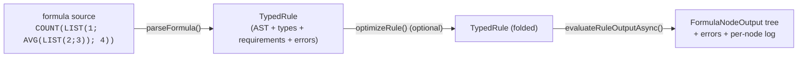
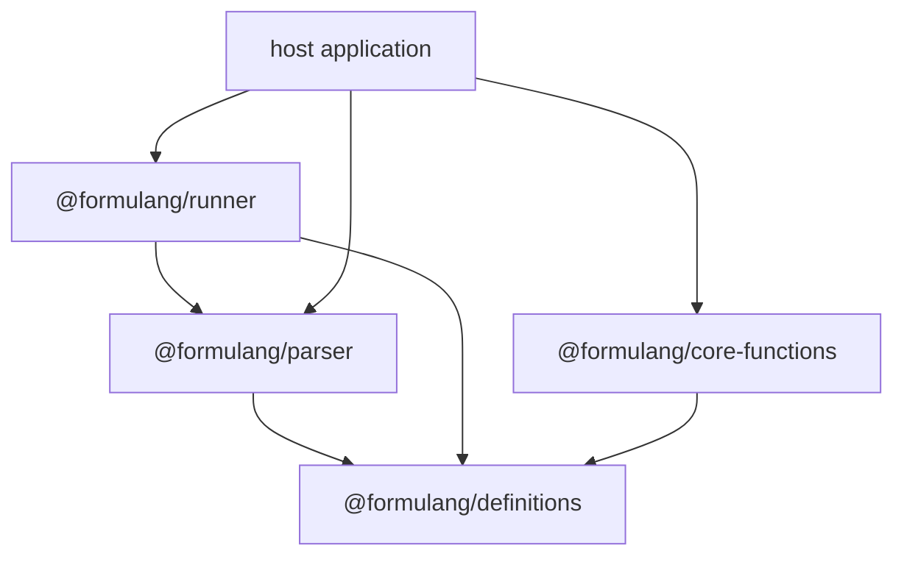
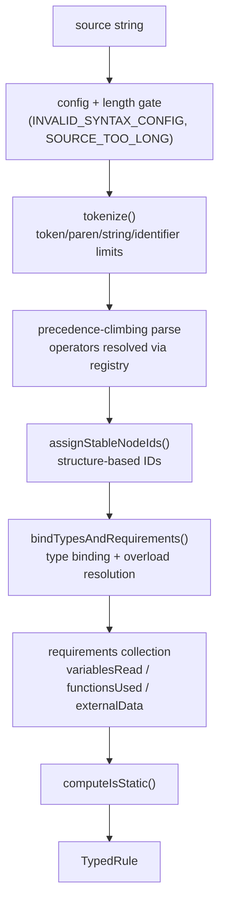
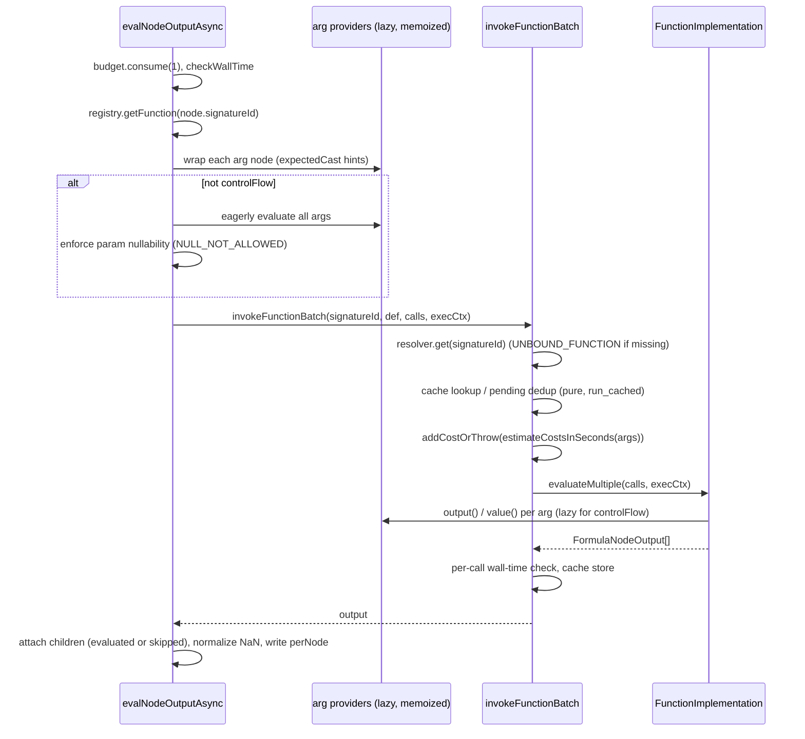

# Architecture

Formulang turns untrusted formula text into a typed, validated AST at parse time, and evaluates that AST asynchronously under strict resource limits at run time. This document describes how the four packages fit together and walks through both halves of that lifecycle in detail.



Related documents: [language.md](language.md) (syntax and semantics), [functions.md](functions.md) (built-in reference), [extending.md](extending.md) (adding functions, operators, variables, types), and [SECURITY.md](../SECURITY.md) (reporting and threat model summary).

## 1. Packages

| Package                     | Directory         | Depends on          | Role                                                                                                    |
| --------------------------- | ----------------- | ------------------- | ------------------------------------------------------------------------------------------------------- |
| `@formulang/definitions`    | `definitions/`    | —                   | Portable contracts: types, AST shapes, registry, limits, error codes. No execution logic.               |
| `@formulang/parser`         | `parser/`         | definitions         | Compiles source text into a `TypedRule` against a registry.                                             |
| `@formulang/runner`         | `runner/`         | definitions, parser | Async evaluation engine: caching, batching, limits, per-node output.                                    |
| `@formulang/core-functions` | `core-functions/` | definitions         | Executable implementations of the built-ins; `createCoreFormulaRuntime()` wires a ready-to-use runtime. |



All published packages have zero third-party runtime dependencies; the only edges are the internal `@formulang/*` ones shown above. The runner's dependency on the parser exists for exactly one shared security primitive, `isDenylistedPropertyName` (see [section 4](#4-security-model)).

### 1.1 Why definitions and core-functions are separate packages

The split is the central design decision of the system: **what a function _is_ (data) is kept apart from what a function _does_ (code)**.

`@formulang/definitions` contains only serializable, side-effect-free contracts. A `FunctionDefinition` is plain data:

```ts
// definitions/src/registry.ts
export interface FunctionDefinition {
  /** The most recent signature identifier for this function definition. */
  signatureId: string;
  name: string;
  aliases?: string[];
  category?: string;
  description: string;
  templates?: TemplateParamDefinition[];
  params: FunctionParamDefinition[];
  returnType: FormulaType;
  purity: FunctionPurity; // 'pure' | 'run_cached' | 'uncached'
  batching?: boolean;
  redaction?: 'none' | 'mask';
  /** If true, the function controls evaluation of arguments (lazy short-circuit). */
  controlFlow?: boolean;
  casts?: Array<{ from: FormulaType; to: FormulaType }>;
}
```

Because it is data-only, the definitions package is safe to load anywhere: a browser-based formula editor, an autocomplete service, a validation endpoint, documentation tooling. Such consumers can parse, type-check, and lint formulas (the parser only needs a `FormulaRegistry` of definitions) without ever holding code that can execute anything.

`@formulang/core-functions` is the backend-only half. It maps signature IDs to `FunctionImplementation` objects — the things that actually run:

```ts
// definitions/src/registry.ts
export interface FunctionImplementation {
  evaluateMultiple: (
    calls: BatchEvaluationCall[],
    ctx: FormulaExecutionContext,
  ) => Array<FormulaNodeOutput> | Promise<Array<FormulaNodeOutput>>;
  estimateCostsInSeconds?: (args: unknown[]) => number;
  tryStaticEvaluate?: (ctx: StaticEvaluationContext) => StaticEvaluationResult | null;
}
```

The two halves meet only through the versioned signature ID string (`"ADD/v1"`). `createCoreFormulaRuntime()` shows the wiring:

```ts
// core-functions/src/index.ts
export function createCoreFormulaRuntime(): FormulaRuntime {
  const registry = createRegistry();
  // Portable, data-only registry entries (safe for editor/embedding reuse).
  registerCoreFormulaDefinitions(registry);
  const implementations = new InMemoryFunctionImplementationRegistry();
  // Backend-only wiring: register executable implementations by signature id.
  registerPrimitiveFormulaImplementations(implementations);
  return { registry, implementations };
}
```

`registerCoreFormulaDefinitions` lives in _definitions_ (`definitions/src/register-core-definitions.ts`) because the built-ins' signatures are portable metadata; `registerPrimitiveFormulaImplementations` lives in _core-functions_ because it constructs executable objects (`implementations.register('ADD/v1', new AddImplementation({ signatureId: 'ADD/v1' }))`).

### 1.2 The registry

`InMemoryFormulaRegistry` (`definitions/src/registry-impl.ts`) implements `MutableFormulaRegistry` and enforces invariants at registration time, so misconfiguration fails at startup rather than mid-evaluation:

- **Versioned signature IDs.** `registerFunction` rejects any `signatureId` not matching `/^[A-Z0-9_]+\/v\d+$/` (`NAME/vN`, e.g. `FILTER/v1`) and rejects duplicates. Stable, versioned IDs are what make cache keys, `requirements.functionsUsed`, and stored compiled rules durable across releases: a breaking change to a function ships as `NAME/v2` under the same user-facing name.
- **Overload ambiguity detection.** `isAmbiguousOverload` scans a bounded arity window; if two overloads of the same name accept the same argument shapes and neither is strictly more specific, registration throws (`Ambiguous overload for LEN: ...`). It does not make the choice independent of registration order: `chooseOverload` binds the first overload, in registration order, that accepts the call, so where one overload takes every call another takes, a call both accept binds the one registered first (§2.4, step 2).
- **Cast uniqueness.** Declared `casts` (e.g. `COUNT`: `List<Any> -> Number`) must be unique per `from => to` pair, and counter-casts (a registered `B => A` when `A => B` exists) are rejected outright.
- **Admitted literal values.** A parameter's `literalValues` must be a non-empty list of texts and sit where the parser checks a literal and a string literal passes its check of the parameter's type: registration reads the same two functions the parser reads, `literalCheckAt` (`definitions/src/literal-checks.ts`: a `literalOnly` parameter at its own position, and past the list a variadic one that lists its admitted values) and `argumentFits` (`definitions/src/type-utils.ts`: any argument fits `any` and a template; otherwise its type must be assignable), both exported. `null` stands for no list, as on the other optional fields, and the stored definition carries none; the parser reads `null` from any registry as no list too, and so a value that is not a list of texts, which only a registry handing definitions on as written can give it.
- **Operators are function aliases.** `OperatorDefinition` carries only `token`, `precedence`, `associativity`, and a `functionSignatureId`; input/output type metadata is filled from the target function if omitted. `implicitCastsAllowed` defaults to true for the comparison tokens (`=`, `<>`, `>`, `>=`, `<`, `<=`).
- **Legacy retirement.** `retireFunction(signatureId)` — or registering a definition with `legacy: true` — retires it from authoring: name/alias lookup, `listFunctions()`, and the ambiguity/cast checks above skip legacy definitions, while `getFunction(signatureId)` still resolves them so stored rules keep evaluating ([best-practices.md §2.3](best-practices.md#23-same-shape-version-bump-retire-the-old-definition-as-legacy-keep-implementations-forever)).

There is also a deliberately smaller contract, `VariableOnlyRegistry` (just `getVariable`/`listVariables`), used by `parseVariableReference` and `evaluateVariableOutputAsync` for accessor-only inputs (`value.snake_name`, `list.*.name`) where function and operator resolution is unnecessary.

## 2. Compile pipeline (`@formulang/parser`)

`parseFormula(source, { registry, limits?, syntax? })` runs the following stages and always returns a `TypedRule` — it never throws:



The result shape:

```ts
// definitions/src/rule.ts
export interface TypedRule {
  root: RuleNode;
  returnType: FormulaType;
  static: boolean;
  requirements: FormulaRequirements;
  errors: FormulaError[];
}
```

and the five AST node kinds (`definitions/src/ast.ts`): `literal`, `variable`, `call`, `property`, `wildcard`. Operators do not survive parsing as a distinct node kind — `1 + 2` becomes a `CallNode` with `signatureId: 'ADD/v1'`.

### 2.1 Tokenize

`tokenize` (`parser/src/tokenizer.ts`) produces `number | string | identifier | operator | lparen | rparen | arg_separator | member_access | eof` tokens and enforces limits as it goes: `maxTokens`, `maxParenDepth`, `maxStringLiteralLength`, `maxIdentifierLength`. Violations throw `FormulaLimitError` (kind `'security'`), which `parseFormula` catches and converts into a collected error.

Syntax is configurable per parse via `FormulaSyntax`:

```ts
// parser/src/syntax.ts
export interface FormulaSyntax {
  argumentSeparator: ';' | ',';
  decimalSeparator: '.' | ',';
}
export const DEFAULT_FORMULA_SYNTAX: FormulaSyntax = {
  argumentSeparator: ';',
  decimalSeparator: '.',
};
```

so `LIST(1; 2; 3)` with `1,23` decimals (the default) and `LIST(1, 2, 3)` with `1.23` decimals are both supported — the pair just has to differ, or the parse fails with `INVALID_SYNTAX_CONFIG` (kind `'config'`). The tokenizer normalizes decimals to `.` internally, handles negative literals positionally (`-1`, `2 + -1` — there is no general unary minus operator), and turns unknown characters into operator tokens so downstream code reports a structured `UNEXPECTED_TOKEN` instead of crashing.

### 2.2 Parse: precedence climbing

`parseBinary` (`parser/src/index.ts`) is a precedence-climbing loop over a `TokenStream`. Crucially, the operator table is _not_ hardcoded — each operator token is looked up in the registry, so embedders can add operators:

```ts
// parser/src/index.ts (parseBinary, condensed)
const op = registry.getOperator(tok.value);
if (!op) break;
if (op.precedence < minPrec) break;
stream.next();
const nextMin = op.associativity === 'left' ? op.precedence + 1 : op.precedence;
const right = parseBinary(stream, source, syntax, registry, errors, nextMin, ..., makeId);
const fn = registry.getFunction(op.functionSignatureId);
left = {
  id: makeId('call', nodeSpan, op.functionSignatureId),
  kind: 'call',
  name: fn?.name ?? op.functionSignatureId,
  signatureId: op.functionSignatureId,   // operators are pre-bound
  args: [left, right],
  span: nodeSpan,
};
```

The core operator registrations (`definitions/src/register-core-definitions.ts`) give the precedence ladder: comparisons `= <> > >= < <=` at 10, additive `+ - &` at 20, multiplicative `* /` at 30, and right-associative `^` at 40.

Postfix accessor chains handle `value.snake_name` (property) and `value.*.id` (wildcard: map a property over a list, flattening one level). Names are validated during parsing: variables and properties must be `lower_snake_case` (`/^[a-z][a-z0-9]*(?:_[a-z][a-z0-9]*)*$/`), function names `UPPER_SNAKE_CASE`, and every property/variable name is checked against the denylist (section 4). `makeId` counts every created node against `limits.maxAstNodes`.

### 2.3 Stable node IDs

After parsing, `assignStableNodeIds` (`parser/src/node-id.ts`) replaces the placeholder IDs with structure-derived ones: a `/`-separated hierarchy of `LABEL-N` segments, e.g. `COUNT-0/LIST-0/TEXT-0`. The counter `N` is scoped per parent, per slot, per fingerprint (`call:ADD`, `var:value`, `lit:NUMBER`, ...), so:

- inserting whitespace or editing text earlier in the formula does not shift IDs (they do not depend on character spans), and
- inserting a sibling with a different fingerprint does not renumber existing nodes.

By default literals fingerprint by type only (`literalFingerprint: 'type'`), so editing `2` to `3` keeps the node's ID. These IDs are the keys of the runner's `PerNodeMap`, which is what lets an editor attach evaluation results and errors to AST positions across edits.

### 2.4 Type binding and overload resolution

`bindTypesAndRequirements` walks the AST bottom-up and annotates every node with a `FormulaType` (`definitions/src/types.ts`: `any | null | boolean | number | text | template | callable | list | object | union`, each with optional `nullable`).

For call nodes:

1. **Operator calls are already bound** (`signatureId` set at parse time); named calls resolve via `registry.listFunctionsByName(name)` (case-insensitive, aliases included).
2. **`chooseOverload`** picks the first candidate whose arity fits (respecting `optional` and trailing `variadic` params) and whose argument base types are assignable to the parameter base types (`isAssignable` from `definitions/src/type-utils.ts`, after `stripNullability` — nullability produces at most a runtime `NULL_NOT_ALLOWED`, not a parse rejection). Registration-time ambiguity checks refuse two overloads that take the same arguments with neither more specific, but the choice still depends on the order of registration where one overload's parameters take all that another's take: a call both accept binds the one registered first, so an overload registered after a wider or equal one is reached only by the calls that one refuses (the core definitions are registered before a host's).
3. If nothing matches but the name exists, a `NO_MATCHING_OVERLOAD` error is emitted; if exactly one candidate exists it is still bound so that per-parameter `ARGUMENT_TYPE_MISMATCH` / `NULL_NOT_ALLOWED` errors can be precise. A host's function loses that binding when a release adds a built-in under its name or under one of its `aliases`, which the registry keys as names: it is then one of two candidates, and a call whose arguments it does not take binds the built-in where the built-in takes them and otherwise fails with `NO_MATCHING_OVERLOAD`. For the sixteen names 1.1.0 adds, a host's four-parameter function called with two, three or five arguments loses 47 of 48 such calls and one binds the built-in (`INDEX_OF` with two), under the name or through an alias, where 1.0.0 bound the host's function for all 48; registration counts an alias as the name too, so a host's one-argument function collides with a built-in that takes the same single argument through an alias as under the name (the compatibility spec measures both, beside a registry shape per name for each). A completely unknown name yields `UNKNOWN_FUNCTION`.
4. **Generics.** Definitions can declare `templates` (`T`, `R`, ...) and use `FormulaTypes.template('T')` in params and return types. `inferGenericBindingsForCall` unifies parameter patterns against actual argument types (drilling through lists and unions), and `substituteTemplates` instantiates the return type. `IF`, `LIST`, `FILTER` (with `FILTER_PROPERTY`), and `EACH` additionally get hand-written return-type refinement (e.g. `LIST(1; 2; 3)` types as `List<number>` and enforces `ARGUMENT_TYPES_MUST_HAVE_SAME_TYPE`; `IF` requires both branches to have the same base type unless one is `NULL`/`Any`), keyed by function name as in 1.0.0; for the higher-order functions the rule sits beside the invocation table (`RESULTS_BY_NAME` in `parser/src/callable-invocations.ts`), and the argument types `EACH`'s result is chosen for are the ones its entry passes the callable. `FILTER_BY`, which 1.1.0 adds, is typed by its definition alone (`List<T?>` from its list argument), so a copy under another signature id types the same and a host's function under that name keeps the result type its own definition declares.
5. **Literal-only callable references.** Higher-order built-ins take functions _by name as string literals_ — there are no closures in the language. `FILTER(LIST(1;2); "NOPE"; 1)` fails at parse time with `UNKNOWN_FUNCTION_REFERENCE`; a non-literal argument fails with `EXPECTED_STRING_LITERAL_REFERENCE`. Parameters declare this with `literalOnly: true` and a `callable` type that can carry `paramTypes` / `returnType` / arity bounds:

```ts
// definitions/src/register-core-definitions.ts (EACH, excerpt)
{
  name: 'operator',
  type: FormulaTypes.callable('function_or_operator', {
    paramTypes: [FormulaTypes.template('T', { nullable: true })],
    returnType: FormulaTypes.template('R', { nullable: true }),
    minArity: 1,
  }),
  literalOnly: true,
},
```

For `EACH` / `FILTER` / `FILTER_PROPERTY` / `FILTER_BY` / `REDUCE`, the parser knows how the callable will be invoked, resolves the referenced function/operator against the registry, checks arity and return type, and — for `EACH` — binds the output template `R` from the referenced callable's return type, so `EACH(LIST("a";"bb"); "LEN")` types as `List<number?>?`. The invocations are one table keyed by function name, `parser/src/callable-invocations.ts`, as 1.0.0 keyed those of `EACH`, `FILTER`, `FILTER_PROPERTY` and `REDUCE`; each entry lists, in order, what the function passes its callable (an item of a list argument, an argument passed on unchanged, every argument from a position on, or a value it supplies when it runs). Every definition whose `name` is one of these gets its entry — a name it answers to only through `aliases` does not count, as on 1.0.0 — so the core definition re-registered under a new signature id keeps its validation, and a host's own function under one of the names is validated as the built-in is — for `FILTER_BY`, which 1.1.0 adds, a cost a host that used the name pays ([extending.md §2.2](extending.md#22-templates-generics-and-callable-parameters)). A definition under another name invokes nothing the parser knows, as on 1.0.0, and no definition can add to the table. Specs reconcile the table, both ways, with every core definition that has a callable parameter, with what each of those functions passes its callable when it runs (at every count of arguments), with what the parser does — each function of the table, registered again under another signature id, parses a set of probes exactly as the core definition does, and a call's type is the one its result rule describes or, without a rule, the type a plain copy of the definition gets — and with the compatibility harness, whose re-versioned shape takes exactly the table's functions; the enumerated-literal matrix takes its higher-order functions, and every position they pass something to, from it. The parser holds each forwarded argument to the referenced parameter's **enumerated-literal** rule: an argument reaching a parameter that lists its admitted `literalValues` (`EACH`'s extras, a filter's `operatorValue`) must be a string literal naming one of them. These higher-order functions call the function behind an operator token, otherwise the first definition of the name that has an implementation, which the parser cannot see (implementations are not part of the portable definitions) and which need not be the overload the argument types select. So the literal must be one that every definition of the name that lists values at that position lists there (`enumeratedTarget` in `parser/src/enumerated-literals.ts`): whichever definition runs then lists the literal or lists nothing at that position, and the refusal names the definitions that do not list it. A call written directly binds the overload its types select and is checked against that overload's list. When the referenced function is itself one of these higher-order functions and names its own callable by a string literal, that literal is followed into the invocation it makes, for every definition of the name, so the rule holds at any depth of callables named by string literals that the walk's bound reaches. The walk (`seedCallable` and `runWalk` in `parser/src/enumerated-literals.ts`) is bounded by construction. Every callable parameter of the call written in the formula seeds one queue, which the walk takes in order: it is iterative and breadth first across all of them, so no recursion depth follows the formula, and where it stops, every level shallower than the one it stopped in has been checked under every callable parameter of the call. It describes what a callable receives as a short head plus a range of the written call's arguments (`PassedSources`, which a spec reconciles with the typed `invokedArguments`), so neither a state's key nor a level's cost grows with the call. It checks each state once — the callable, the name of the function invoking it, and where each argument comes from — so overloads that follow the same callable along several reference kinds cost one visit. It checks a literal, and follows a callable, exactly where `literalCheckAt` answers — the rule the written call and registration read too — so a callable parameter that is not literal-only is followed nowhere, and a variadic callable parameter at every further argument when it lists its admitted values and at the first only when it lists none. It takes every callable the call names by a string literal, whether or not one of its overloads takes the arguments it is passed, as it does at every level below, where no overload is chosen. A spec (`parser/src/literal-checks.spec.ts`) drives the parser over a matrix of parameters (types, lists, literal-only or not, variadic extras) × the table's functions that pass a written argument on, with their callable parameter literal-only or not, and requires the same refusals written directly, one level and two levels away, and registration to take a list exactly where the parser checks literals against it. And it visits at most 16 × (n + 1) argument positions for a call of n arguments written in the formula, one budget for all of its callable parameters: a level visits no more positions than the widest definition of the function it names has parameters, or every argument it receives where a variadic last parameter lists its admitted values; that is five for the built-in functions, so with the built-in definitions the bound is never reached; past it the walk stops following, never throws and never refuses a formula for its cost, and a mode it leaves reaches the function when the call runs. The specs that hold the walk to these guarantees read what the parser did, not a copy of it: `parser/src/work-trace.ts` records each walk's queue and visits in order, and units of work, fed by the production code only while a spec observes a parse (`observeWork`), and is not part of the package's entry point. One spec counts the positions the walk visits for chains of 100 to 12,000 arguments, through the core `EACH` and through a host's `EACH` with a variadic callable, and holds them between one and three per argument. Another holds the walk of real parses (chains, chains that branch at every level, calls whose refused literal sits under the first or the second of two callable parameters, the extra arguments of a variadic callable parameter that lists its callables, and a call whose every argument is a callable parameter) to one breadth-first queue: every callable the call names queued before the first visit, each state queued once and visited in the order queued, depths that never decrease, every state shallower than where it stops visited at every position, and the bound 16 × (n + 1), written as a number in the spec. The checks of the callables a call names share what depends on the call alone: what it passes its callables, the templates its arguments bind, and the overload each name chooses are worked out once per call, so a variadic callable parameter that lists its admitted values, which makes every argument of the call a callable parameter, costs work linear in the call; a spec counts the argument types the checks of such a call read (the work record's `arguments` units), from 10 to 3,000 arguments, and holds them between n and 16 × (n + 1). A callable that a higher-order call passes on can also be named by a variable or an expression; as in 1.0.0 it is resolved when the call runs, so the parser checks nothing it receives. Every built-in function also checks the mode it receives when it runs, wherever the mode comes from, and answers a mode it does not list with `null` and a `TYPE` warning; a core higher-order function that called it keeps the `null` and drops the warning (as in 1.0.0), so through `EACH` that item is `null`, with no error and no warning. A name passed on that the registry does not know makes that call yield `null`.

6. **Enumerated literals.** A literal-only parameter may also declare `literalValues`, the exact strings it admits (a mode switch, for example). The parser refuses any other literal with `LITERAL_VALUE_NOT_ALLOWED`, naming the admitted values in the message — also for a literal higher-order calls pass on, at any depth of callables named by string literals within the walk's bound (step 5) — so a misspelt mode written in the formula is a compile error. The built-in implementations still check the mode they receive, wherever it comes from, and a custom one should ([extending.md §2.1](extending.md#21-parameters)): a callable that a nested higher-order call names by a variable or an expression, a higher-order function an embedder registers under a name of its own, a callable past the first argument of a variadic callable parameter that lists no admitted values, a callable named at a callable parameter that is not literal-only, and a level past the walk's bound receive or pass on values the parser does not check ([language.md](language.md#when-a-mode-is-checked) has the exact split, and what a formula answers for them). The list is plain data on the definition, which is what lets an editor offer the values as completions; registration rejects an empty list, a value that is not a list of texts, and a list on a parameter that is not `literalOnly` or whose type no string literal fits, which would refuse every call as an empty list would.

### 2.5 Requirements collection

Alongside binding, the parser fills:

```ts
// definitions/src/requirements.ts
export interface FormulaRequirements {
  variablesRead: string[];
  functionsUsed: string[];
  externalData: Array<{ kind: string; value: unknown }>;
  estimatedCostUnits: number;
}
```

- **`variablesRead`** contains full accessor paths, not just root names: `collectVariablesReadPaths` collapses property/wildcard chains, so `value.*.id` records `"value.*.id"`. Hosts use this to fetch or authorize exactly the data a stored formula needs before evaluating it.
- **`functionsUsed`** is the deduplicated list of bound signature IDs (`"ADD/v1"`, `"EACH/v1"`), useful for capability checks and cache invalidation when implementations are versioned.
- **`externalData`** collects references discovered from static arguments — the `StaticEvaluationResult.externalData` channel; `optimizeRule` merges anything found while folding.
- **`estimatedCostUnits`** is reserved for parse-time cost estimates; the parser currently leaves it at `0` and cost enforcement happens at run time (section 3.6).

### 2.6 Static and predictable-value analysis

Two related notions are computed:

- **`predictableValue`** (per node): literals get it trivially; property access over a predictable object propagates it; the parser also special-cases known-constant calls (`EMPTY()`/`BLANK()` is always `null`).
- **`TypedRule.static`** (whole rule): `computeIsStatic` returns true when the tree contains no variables, every call resolves to a definition with `purity: 'pure'`, and any accessor node carries a parse-time predictable value. A static rule always produces the same value, so hosts can evaluate it once and store the result.

`optimizeRule` (`definitions/src/optimize.ts` — deliberately in the portable package, since folding is data-in/data-out) conservatively rewrites call nodes into literal nodes when `predictableValue` is present and the subtree is fully static, keeping node IDs, and merges discovered `externalData` into the requirements. The `FunctionImplementation.tryStaticEvaluate` hook is the contract for implementation-assisted folding (e.g. resolving a reference embedded in a literal argument); the shipped optimizer only folds parser-computed predictable values.

### 2.7 Errors are collected, never thrown

Every stage appends to `TypedRule.errors` instead of throwing. Limit violations thrown inside tokenization/parsing (`FormulaLimitError`) are caught and converted; any unexpected exception becomes a `PARSER_CRASH` entry. The error shape and kind taxonomy live in `definitions/src/errors.ts`:

```ts
export type FormulaErrorKind = 'parse' | 'type' | 'runtime' | 'security' | 'config';

export interface FormulaError {
  kind: FormulaErrorKind;
  code: FormulaErrorCode; // one of FormulaErrorCodes
  message: string;
  span?: SourceSpan; // { start, end } character offsets
  path?: string[];
}
```

| Kind       | Meaning                                                       | Representative codes                                                                                                                                                                                                                                                                                                                                                                |
| ---------- | ------------------------------------------------------------- | ----------------------------------------------------------------------------------------------------------------------------------------------------------------------------------------------------------------------------------------------------------------------------------------------------------------------------------------------------------------------------------- |
| `parse`    | Source text does not form a valid expression                  | `UNEXPECTED_TOKEN`, `EXPECTED_RPAREN`, `EXPECTED_PROPERTY`, `INVALID_FUNCTION_NAME`, `INVALID_VARIABLE_NAME`, `INVALID_PROPERTY_NAME`, `PARSER_CRASH`                                                                                                                                                                                                                               |
| `type`     | Expression is well-formed but ill-typed                       | `UNKNOWN_VARIABLE`, `UNKNOWN_FUNCTION`, `NO_MATCHING_OVERLOAD`, `ARGUMENT_TYPE_MISMATCH`, `ARGUMENT_TYPES_MUST_HAVE_SAME_TYPE`, `NULL_NOT_ALLOWED`, `PROPERTY_TARGET_NOT_OBJECT`, `WILDCARD_TARGET_NOT_LIST`, `EXPECTED_STRING_LITERAL_REFERENCE`, `LITERAL_VALUE_NOT_ALLOWED`, `UNKNOWN_FUNCTION_REFERENCE`                                                                        |
| `security` | A protection triggered (parse-time limits or run-time guards) | `SOURCE_TOO_LONG`, `TOO_MANY_TOKENS`, `TOO_MANY_AST_NODES`, `PARENS_TOO_DEEP`, `STRING_LITERAL_TOO_LONG`, `IDENTIFIER_TOO_LONG`, `DENYLISTED_PROPERTY`, `PROPERTY_NOT_ALLOWLISTED`, `EVAL_LIMIT_EXCEEDED`, `COST_LIMIT_EXCEEDED`, `FUNCTION_COST_LIMIT_EXCEEDED`, `WALL_TIME_LIMIT_EXCEEDED`, `LIST_TOO_LARGE`, `WILDCARD_OUTPUT_TOO_LARGE`, `REGEX_UNSAFE`, `REGEX_INPUT_TOO_LONG` |
| `runtime`  | Evaluation-time failure                                       | `UNBOUND_FUNCTION`, `EVAL_CRASH`, `OUTPUT_TYPE_NOT_ALLOWED`, plus runtime occurrences of `NULL_NOT_ALLOWED` / `UNKNOWN_FUNCTION`                                                                                                                                                                                                                                                    |
| `config`   | Embedder misconfiguration                                     | `INVALID_SYNTAX_CONFIG`                                                                                                                                                                                                                                                                                                                                                             |

A `TypedRule` with errors is still a complete tree (error recovery inserts `null` literals), so editors can render diagnostics with spans while keeping the rest of the formula typed.

## 3. Runtime (`@formulang/runner`)

Entrypoints (`runner/src/evaluate.ts`):

- `evaluateRuleOutputAsync(rule, ctx)` — source of truth; returns `{ output: FormulaNodeOutput, errors: FormulaError[], perNode: PerNodeMap }`.
- `evaluateRuleAsync(rule, ctx)` — convenience wrapper returning `{ value, errors, perNode }` (the root output's value).
- `evaluateVariableOutputAsync(compiled, ctx)` — variable/property/wildcard-only ASTs against a `VariableOnlyRegistry`; no function resolver required.
- `evaluateRule` — the synchronous API is deprecated and throws immediately.

### 3.1 EvaluateContext anatomy

```ts
// runner/src/evaluate-types.ts
export interface EvaluateContext {
  registry: FormulaRegistry; // definitions for lookups/redaction
  resolver: FunctionImplementationResolver; // signatureId -> FunctionImplementation
  variables: Record<string, unknown>; // values or async resolver functions
  limits?: Partial<FormulaLimits>; // merged over DEFAULT_FORMULA_LIMITS
  budget?: FormulaEvaluationBudget; // shared step budget (optional)
  cache?: Map<string, unknown>; // shared cache for `pure` results
  pending?: Map<string, Promise<unknown>>; // shared in-flight promises for `pure` calls
}
```

At the start of a run, `evaluateRuleOutputAsync` resolves limits, creates the step budget (`maxEvaluationSteps`) if none was passed, best-effort freezes the variables object (`deepFreezeLimited(ctx.variables, 6, 2000)`) so implementations cannot mutate host data, and builds an internal `RunnerState`:

```ts
// runner/src/internal/state.ts
export type RunnerState = {
  startedAt: number;
  limits: FormulaLimits;
  budget: FormulaEvaluationBudget;
  pureCache: Map<string, unknown>; // = ctx.cache (shared across runs if provided)
  purePending: Map<string, Promise<unknown>>;
  runCache: Map<string, unknown>; // always fresh per run
  runPending: Map<string, Promise<unknown>>;
  totalCostUnits: number;
};
```

Variables may be plain values or resolver functions. If `ctx.variables[name]` (or an object property reached during accessor evaluation) is a function, the runner calls it with `{ registry, limits, budget }`, awaits the result, and applies the per-function wall-time limit — this is how lazy or remote data is injected without teaching the runner about data sources (`runner/src/internal/variables.ts`).

### 3.2 Evaluating a call node



**Implementation resolution** is a single map lookup by versioned signature ID: `execCtx.resolver.get('ADD/v1')`. A definition without a registered implementation produces a structured `UNBOUND_FUNCTION` error output — parse-time binding guarantees the _definition_ exists, not the code.

**Argument providers.** Each argument node is wrapped in a memoized `FormulaValueProvider`:

```ts
// definitions/src/value-provider.ts
export interface FormulaValueProvider {
  output(): Promise<FormulaNodeOutput>; // full child output incl. errors/warnings
  value(): Promise<unknown>; // unwrapped value convenience
}
```

For ordinary functions the runner evaluates all providers eagerly before invoking, then enforces declared parameter nullability. For definitions with `controlFlow: true` (`AND`, `OR`, `NOT`, `IF`, `SWITCH`, `REDUCE`), the providers are handed over unevaluated and the implementation decides what to pull — this is how short-circuiting works:

```ts
// core-functions/src/functions/and.ts (evaluateMultiple, excerpt)
for (const provider of call.args) {
  const child = await provider.output();
  const v = normalizeBooleanLike(child.value);
  if (v === null) { out = makeError('AND', { kind: 'runtime', code: 'TYPE', ... }); break; }
  if (v === false) { out = makeOkBoolean('AND', false, ...); break; }
}
```

`IF` evaluates the condition and then only the chosen branch; `SWITCH` stops at the first matching case. Providers that were never pulled are recorded as `skipped` subtrees in both the output tree and the per-node map, so the evidence trail distinguishes "evaluated to X" from "intentionally not evaluated".

**Batching.** The execution contract is batch-first: `evaluateMultiple(calls, ctx)` takes a list of `BatchEvaluationCall`s (`{ args, expectedCast?, callId? }`). The runner invokes with a single call per AST node, but higher-order built-ins fan out internally through the same interface — `EACH` and `FILTER` build one `BatchEvaluationCall` per list item (with `callId: `${idx}``, consuming one budget step each) and pass the whole batch to the referenced implementation in a single `evaluateMultiple` call, so a batching-aware implementation (e.g. one that talks to an external service) can service all items at once. Simple functions avoid the boilerplate with the shared base class:

```ts
// core-functions/src/functions/abstract-eager-batch-implementation.ts
export abstract class AbstractEagerBatchImplementation<
  TConfig extends BaseFunctionConfig = BaseFunctionConfig,
> implements FunctionImplementation {
  async evaluateMultiple(calls: BatchEvaluationCall[], ctx: FormulaExecutionContext) {
    const outs: FormulaNodeOutput[] = [];
    for (const call of calls) {
      const argValues = await Promise.all(call.args.map((p) => p.value()));
      outs.push(await this.evaluate(argValues, ctx));
    }
    return outs;
  }
  protected abstract evaluate(
    args: unknown[],
    ctx: FormulaExecutionContext,
  ): FormulaNodeOutput | Promise<FormulaNodeOutput>;
}
```

The base class is internal to `@formulang/core-functions` — the package's public entry point exports only `createCoreFormulaRuntime` (and the `FormulaRuntime` type). Embedders writing custom functions implement `FunctionImplementation` directly or copy this ~20-line pattern; see [extending.md](extending.md#31-the-eager-batch-pattern).

**Expected-cast hints.** The runner propagates `expectedCast` hints downward: comparison operators push `number?` at their operands (`expectedCastForComparison`), a single-argument function that declares `casts` (like `COUNT`) pushes its return type at its argument, and every other argument receives the declared parameter type as its hint. Implementations receive the hint via `BatchEvaluationCall.expectedCast` / `ctx.expectedReturnType` and may use it to coerce; it also participates in cache keys.

### 3.3 Purity and the two cache scopes

`FunctionPurity` drives caching:

| Purity       | Cache                                   | Scope                                                                                            |
| ------------ | --------------------------------------- | ------------------------------------------------------------------------------------------------ |
| `pure`       | `state.pureCache` / `state.purePending` | Cross-run, if the host passes `ctx.cache` / `ctx.pending`; otherwise per-run                     |
| `run_cached` | `state.runCache` / `state.runPending`   | Always a fresh map per `evaluateRuleOutputAsync` call — deterministic within a run, never shared |
| `uncached`   | none                                    | `NOW`, `TODAY`, and friends re-execute every time                                                |

Guards in `invokeFunctionBatch` (`runner/src/internal/invoke.ts`):

- control-flow functions are never cached (their unevaluated-argument semantics make keys unstable);
- caching is skipped when any argument fails `isCacheableByArgs` — a string argument (or a string inside a nested list, scanned to bounded depth) longer than `limits.maxCacheableStringLength` opts the call out, preventing cache memory from ballooning;
- keys are `signatureId | cast | stable-arg-keys` (`cacheKey` in `runner/src/internal/cache.ts`): primitives by value (with `-0`/`NaN` stabilized), small primitive arrays by value, everything else by object identity via a `WeakMap` ID — no deep serialization of untrusted data;
- the `pending` maps deduplicate concurrent in-flight calls with the same key (the second caller awaits the first's promise);
- only `ok` outputs without warnings are stored, and only the _value_ is stored — cached hits are rehydrated with `makeOkUnknown`, and outputs that carry warnings are recomputed so warning evidence is never lost. Errors are never cached.

### 3.4 Per-node execution output and redaction

Evaluation produces two views:

1. **`FormulaNodeOutput`** — the full evidence tree (`definitions/src/execution-output.ts`): per node `ok`, `name`, `signatureId?`, `value`/`valueKind`/`valueObjectKind`, `warnings?`, `error?`, ordered `children` (always present), `nodeId`, `span`, and `skipped?: true` for short-circuited subtrees. Warnings (`FormulaWarning`) are the soft-failure channel: built-ins like `ADD("x"; 1)` return an `ok` null _with_ a `TYPE` warning rather than failing the whole formula.
2. **`PerNodeMap`** — a flat `Record<nodeId, PerNodeEntry>` debug log keyed by the stable node IDs from section 2.3, with `{ span, value | error, skipped?, redacted?, truncated? }`.

The per-node log is where **redaction and truncation** apply (`runner/src/internal/per-node.ts`). If the node's function definition or the base variable of its accessor chain declares `redaction: 'mask'`, the logged value is replaced by `{ __redacted: true }`. Otherwise values are truncated for logging using the `maxLogged*` limits (depth 6, 50-char strings, 10 list items, 10 object keys by default); truncated entries keep a preview plus an FNV-1a hash so two truncated values can still be compared for equality. The output tree itself carries raw values — hosts choose which view to expose.

### 3.5 Failure vs crash semantics

Two distinct channels, by design:

- **Failure** — an implementation returns `ok: false` with a structured `FormulaExecutionError` (via `makeError`), or `ok: true` with warnings. The runner records the error into the run's `errors` array and the per-node map, and evaluation of the _rest_ of the tree proceeds normally where possible. Node-level failures compose: a failed child surfaces through its parent's output.
- **Crash** — an exception. Implementations and the runner throw `FormulaRuntimeError(code, message, kind)` for hard stops (all resource-limit violations use `kind: 'security'`). `evalNodeOutputAsync` wraps every node evaluation in a try/catch: a thrown `FormulaRuntimeError` keeps its code and kind; any other exception becomes `EVAL_CRASH`. Either way the crash is converted at the nearest node boundary into an error output whose children are marked skipped — even a limit blow-up mid-list yields a structured result instead of an exception reaching the host.

Numeric hygiene is enforced at the boundaries: `makeOkNumber` refuses to emit `NaN`/`Infinity` (returns null instead), variable resolvers and call results are normalized the same way, and an `expectedReturnType` mismatch on the final output produces `OUTPUT_TYPE_NOT_ALLOWED` (`valueSatisfiesType` in `runner/src/internal/value-utils.ts`).

### 3.6 Resource limiting during evaluation

All limits live in one place — `FormulaLimits` / `DEFAULT_FORMULA_LIMITS` (`definitions/src/limits.ts`), overridable per call via `resolveFormulaLimits`:

- **Step budget.** `FormulaEvaluationBudget` starts at `maxEvaluationSteps` (default 30,000). Every node consumes 1 step; wildcard expansion consumes one per list item; `EACH`/`FILTER` consume one per item call. Exhaustion throws `EVAL_LIMIT_EXCEEDED` (security). Hosts can pass one budget across several evaluations to cap a whole batch.
- **Wall time.** `checkWallTime` enforces `maxWallTimeMs` (default 15 s) for the run; each function invocation and each variable resolver call is additionally checked against `maxFunctionWallTimeMs` (default 10 s).
- **Cost units.** Before invoking, the runner asks the implementation for an estimate: `estimateCostsInSeconds(argValues)`. A single call over `maxFunctionCostUnits` (default 2) throws `FUNCTION_COST_LIMIT_EXCEEDED`; the running total over `maxTotalCostUnits` (default 5) throws `COST_LIMIT_EXCEEDED`. A missing or non-finite estimator falls back to a conservative 0.05 units per call, and control-flow functions are charged a flat 0.05 (`runner/src/internal/state.ts`).
- **Dynamic cost tagging.** Cost estimators often run against argument values; when a value is not a real string/list, the core-functions helpers `assumedTextLength` / `assumedListLength` (`core-functions/src/functions/helpers.ts`) check for a `{ __formula_dynamic_cost: true, kind: 'text' | 'list' }` placeholder and assume average sizes — 50 chars / 10 items (untagged unknown values fall back to the same assumptions). This lets hosts pre-estimate the cost of a call with placeholder args before the real data exists. Separately, values carry a runtime type tag `__formula_object_kind` (e.g. `'date' | 'time' | 'datetime'` on the datetime built-ins' outputs), which `valueSatisfiesType` uses to match clarified object types and `TO_TEXT`/`ISDATE` use for date-like detection. Because every `__`-prefixed name is denylisted, these tags are visible to the engine but unreachable from formula code.
- **Size caps.** `maxListLength` (1,000) gates wildcard targets and `EACH`/`FILTER` inputs (`LIST_TOO_LARGE`); `maxWildcardOutputLength` (5,000) caps flatten expansion (`WILDCARD_OUTPUT_TOO_LARGE`); `maxRegexPatternLength` (100) and `maxRegexTextLength` (8,000) gate the regex built-ins.

### 3.7 End-to-end example

The exact wiring used throughout the test suites (`core-functions/src/test-helpers/eval-formula.ts`):

```ts
import { FormulaTypes, optimizeRule } from '@formulang/definitions';
import { parseFormula } from '@formulang/parser';
import { evaluateRuleOutputAsync } from '@formulang/runner';
import { createCoreFormulaRuntime } from '@formulang/core-functions';

const { registry, implementations } = createCoreFormulaRuntime();
registry.registerVariable({
  name: 'value',
  description: 'A test input value.',
  type: FormulaTypes.list(FormulaTypes.text(true), true),
});

const parsed = parseFormula('EACH(value; "LEN")', { registry });
const compiled = optimizeRule(parsed, { registry });
const { output, errors, perNode } = await evaluateRuleOutputAsync(compiled, {
  registry,
  resolver: implementations,
  variables: { value: ['a', 'bb'] },
});
// output.value -> [1, 2]
```

## 4. Security model

Formulang assumes formula source is untrusted and variable data is sensitive. The protections form two layers; every violation is a structured error (`kind: 'security'`), never an unhandled throw.

**Parse-time (static rejection — bad formulas never reach the runner):**

| Protection                       | Mechanism                                                                                                                                                                                                                                                             |
| -------------------------------- | --------------------------------------------------------------------------------------------------------------------------------------------------------------------------------------------------------------------------------------------------------------------- |
| Property allowlisting            | Property access requires the target's declared `ObjectType.properties` to contain the name (`PROPERTY_NOT_ALLOWLISTED`); access on `any`/`template`-typed targets is rejected outright, so unknown data shapes cannot be probed. Same rule per element for wildcards. |
| Prototype-pollution denylist     | `isDenylistedPropertyName` (`parser/src/denylist.ts`) rejects `__proto__`, `prototype`, `constructor`, and _any_ `__`-prefixed name for variables, properties, and wildcards (`DENYLISTED_PROPERTY`).                                                                 |
| Input-size limits                | `maxSourceLength`, `maxTokens`, `maxStringLiteralLength`, `maxIdentifierLength`, `maxParenDepth`, `maxAstNodes` — enforced during tokenization and node creation.                                                                                                     |
| Naming discipline                | Strict `lower_snake_case` / `UPPER_SNAKE_CASE` regexes keep the identifier space predictable.                                                                                                                                                                         |
| Literal-only callable references | Higher-order arguments must be string literals validated against the registry — a formula cannot construct a function reference dynamically.                                                                                                                          |
| Type binding                     | Full overload resolution means only registered signatures with compatible argument types are ever bound.                                                                                                                                                              |

**Eval-time (defense in depth — the runner re-checks and contains):**

- Denylist and allowlist checks are repeated per node in `evalNodeOutputAsync`. The denylist re-check is name-based and holds even against a tampered AST; the allowlist re-check validates against the type metadata the AST itself carries, so it catches stale or hand-edited property nodes but not an artifact whose type metadata was tampered with as well — store compiled rules where formula authors cannot write ([best-practices.md §1.5](best-practices.md#15-treat-stored-compiled-rules-as-trusted-artifacts)).
- Property reads use `Object.prototype.hasOwnProperty` (`readOwnProperty`), never the prototype chain.
- `DISTINCT` and `GROUP_COUNTS` compare only text, numbers, booleans, and date/time values (by kind and `iso`); a list, the empty list included, or another object answers `null` with a `TYPE` warning. `INDEX_OF` compares as `INCLUDES` does, an object only as the same value object, and answers a list with `null` and a `TYPE` warning.
- Resource limits: step budget, run and per-call wall time, cost units, list/wildcard caps (section 3.6).
- Regex built-ins reject unsafe patterns before compiling: length caps, no backreferences, no lookbehind, and a heuristic ReDoS check (`isProbablySafeRegex` rejects nested/alternating quantified groups like `(a+)+`) — `REGEX_UNSAFE`.
- Input variables are frozen (`deepFreezeLimited`) at the start of a run; implementations receive values, not host object graphs to mutate.
- `NaN`/`Infinity` never escape as numbers; final outputs can be shape-checked against an `expectedReturnType` (`OUTPUT_TYPE_NOT_ALLOWED`), with clarified object types verified via the `__formula_object_kind` tag.
- Cache keys avoid deep serialization of untrusted values and oversized strings are excluded from caching entirely.
- Per-node debug logs honor `redaction: 'mask'` on variables and functions and truncate large values.
- Zero third-party runtime dependencies in all four packages keeps the supply-chain surface at the platform itself.

See [SECURITY.md](../SECURITY.md) for the vulnerability disclosure process.

## 5. Extension points

Full walkthroughs with code are in [extending.md](extending.md). The surface, in one list:

- **Custom functions.** Register a data-only `FunctionDefinition` (`registry.registerFunction`) with a `NAME/vN` signature ID, then register a matching `FunctionImplementation` (`implementations.register(signatureId, impl)`). Implement `evaluateMultiple` directly — eagerly resolving the argument providers for ordinary functions, or pulling them lazily for control-flow and batch-aware functions — or copy the small eager-batch base class from section 3.2 (`AbstractEagerBatchImplementation` is internal to `@formulang/core-functions`, not a public export). `FunctionImplementationClass` / `BaseFunctionConfig` (`definitions/src/function-implementation-class.ts`) give the class-shaped contract; [extending.md](extending.md#3-implementing-a-function) has the complete walkthrough.
- **Custom operators.** `registry.registerOperator({ token, precedence, associativity, functionSignatureId })` — the parser picks new operators up automatically (section 2.2).
- **Variables.** `registry.registerVariable({ name, type, description?, redaction? })` with allowlisted object types built via `FormulaTypes.object(clarifier, properties)`; supply values or async resolver functions at evaluation time.
- **Types.** Compose `FormulaTypes.*` builders (including `template`, `union`, `callable`) in definitions; `createDefaultRuleTypes()` (`definitions/src/rule-types-core.ts`) provides the primitive seed.
- **Behavioral flags.** `purity` (caching tier), `controlFlow` (lazy arguments), `redaction`, `casts`, `aliases`, `estimateCostsInSeconds` (cost limiting), `tryStaticEvaluate` (constant folding).
- **Environment.** Per-call `limits` overrides (`resolveFormulaLimits`), syntax configuration (`FormulaSyntax`), shared `cache`/`pending`/`budget` across evaluations, and a custom `FunctionImplementationResolver` if implementations live somewhere other than an in-memory map.
